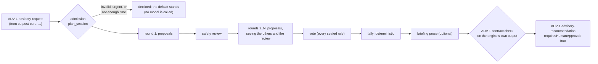

# ADV-1 and the roundtable engine

How a non-urgent fleet question becomes a recommendation, what the engine
guarantees about it, and what it does not. Code: [`jac/roundtable/`](../jac/roundtable/).
Schemas: [`schemas/`](../schemas/). Design background:
[`roundtable-design.md`](roundtable-design.md).

## What the requester controls

A request names a closed list of `options`, a `defaultChoice` among them, and a
`decideBy` time. The roundtable chooses **among those options only**; it cannot
propose an action the requester did not enumerate, which is what keeps an
agent's free text from becoming an action. `defaultChoice` is what happens if
nobody approves a recommendation by `decideBy`, so the fleet never waits on this
layer.

Requests with `urgency` other than `deliberative` are refused by the schema:
time-critical hazards belong to Tier 0 and never reach this layer.

## Phases

1. **Admission** (`plan_session`). The request must pass the contract check, at
   least `min_deliberation_s` (default 600) must remain before `decideBy`, and
   the roster must seat enough roles for the request's `topic`: at least
   `min_participants` (default 3), at least one safety critic, at least one
   proposer. Otherwise the outcome is `declined` and no model is called.
2. **Rounds of proposals.** Each non-critic role states which option it favours,
   with a rationale, risks and a confidence. From round 2 it sees the previous
   round and the safety review, and may change its mind.
3. **Safety review**, once, after round 1. The critic does not propose. It lists
   issues, may flag options as unsafe, and gives a short test matrix.
4. **Vote.** Every seated role, critics included, votes for one option.
5. **Tally** (below), then an optional **briefing**: a model writes a few
   sentences of prose *after* the decision is fixed. The summary always opens
   with a sentence the engine builds from the tally, so prose cannot contradict
   the vote.
6. **Contract gate.** The recommendation is checked against the ADV-1 schema and
   the audit rules before it is returned. A failure is reported as `failed`,
   never emitted.

## How the outcome is decided

All of this is in [`tally.jac`](../jac/roundtable/tally.jac); no model takes part.

- A vote counts only if its choice is one of the request's options and its
  confidence is within [0, 1]. Otherwise the role is listed under
  `process.abstained` with the reason.
- **Quorum:** more than half of the seated roles must have cast a valid vote.
- The option with the most votes wins; equal counts are broken by the sum of
  the voters' confidences.

| `process.basis` | Meaning | Recommendation |
|---|---|---|
| `unanimous` | every valid vote agreed | that option |
| `plurality` | a clear winner, with dissent | the winner |
| `tie-default` | first place tied on votes and confidence | the request's default |
| `no-quorum-default` | not more than half cast a valid vote | the request's default |
| `safety-block-default` | the winner was flagged unsafe by the safety critic | the request's default |

The critic can only move the outcome **toward** the requester's default, never
away from it, and only for a non-default winner. A block naming something that
is not an option is ignored and noted.

## What can go wrong, and what happens

| Situation | Result |
|---|---|
| A model call fails (network, key, provider error) | That role's position or vote is missing; noted in `process`. Only the exception's class name is recorded, never its message. |
| A model returns an unlisted option, or a confidence outside [0, 1] | The answer is discarded; the role abstains. |
| Most roles fail | `no-quorum-default`: a valid recommendation equal to the default, with every failure listed. The CLI warns on stderr. |
| `decideBy` passes mid-session | `expired`: no recommendation, because the default already applies. |
| The briefing call fails | The deterministic summary stands alone. |
| An agent's text tries to instruct another agent | It can only change that agent's vote among the listed options, which are counted or discarded like any other. |

## Audit

`tools/validate.py` (and `adv1_contract.check`) re-derives the outcome from the
votes a recommendation reports, using the same rule but a separate
implementation (Python). A recommendation whose `recommendation` or `basis` the
votes do not support is rejected, as is one that is later than `decideBy`. The
tests run both implementations against random votes and require them to agree.

## What this does not guarantee

- **Quality of advice.** The guarantees above are about structure and safety of
  the process. Whether the agents reason well depends on the models and
  prompts, which have only been exercised with scripted answers.
- **Independence of the agents.** Later rounds show agents each other's
  rationales, so they can converge on one error. Using different providers per
  role (the roster allows it) is the mitigation, and is untested here.
- **A reviewer's judgement.** `requiresHumanApproval` is a field, not a
  mechanism: the system that consumes a recommendation must actually wait for a
  human, and apply `defaultChoice` at `decideBy`.
